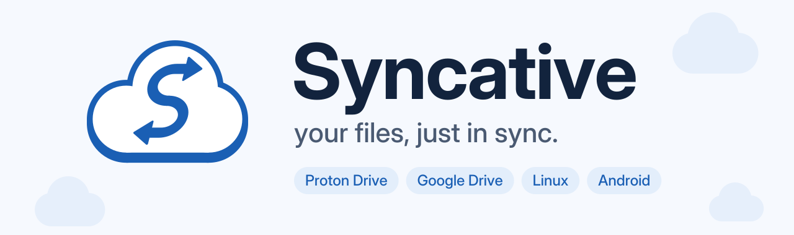
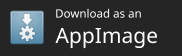
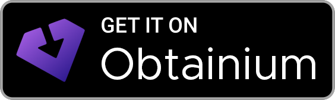
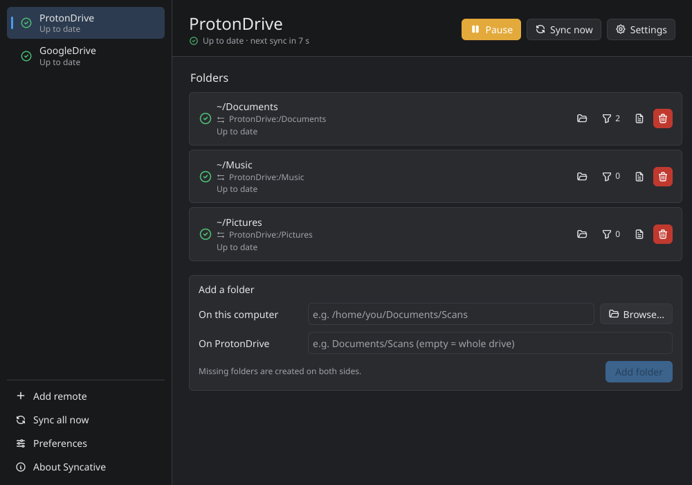
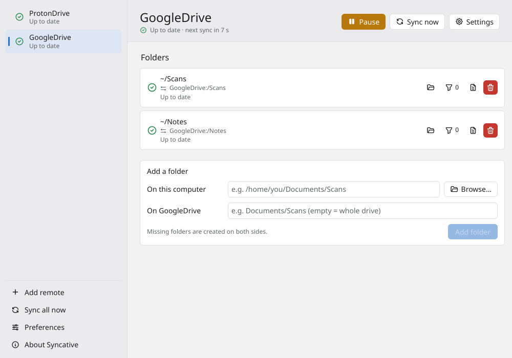
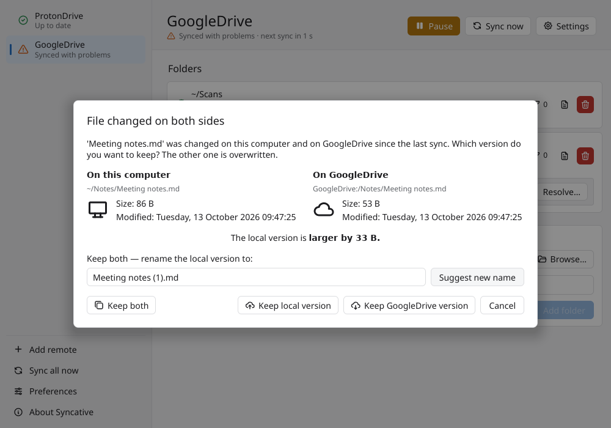
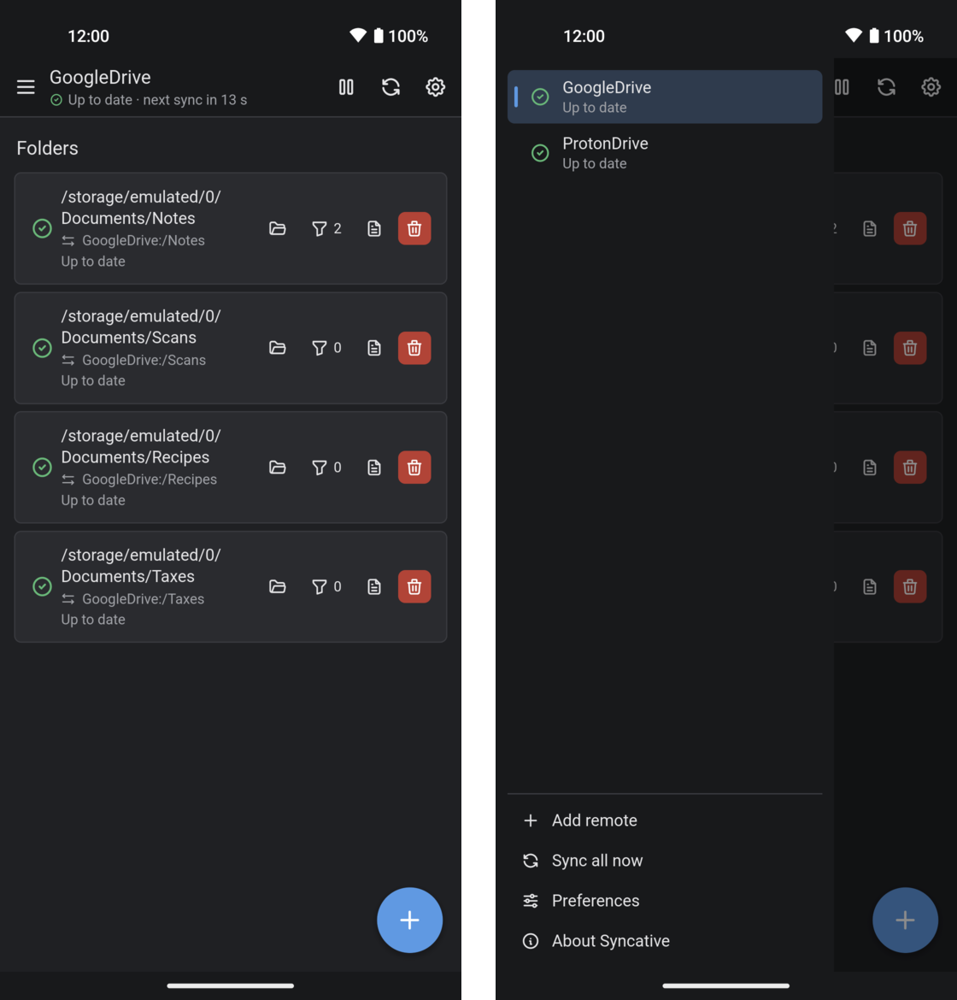

<picture>
  <source media="(prefers-color-scheme: dark)" srcset="assets/syncative-banner-wide-dark.svg">
  
</picture>

Two-way file sync between folders on your Linux computer or Android phone and Google Drive or Proton Drive.

<p>
  <a href="https://github.com/Santuzius/syncative/releases/latest"></a>
  <a href="https://apps.obtainium.imranr.dev/redirect?r=obtainium://app/%7B%22id%22%3A%22io.github.santuzius.syncative%22%2C%22url%22%3A%22https%3A%2F%2Fgithub.com%2FSantuzius%2Fsyncative%22%2C%22author%22%3A%22Santuzius%22%2C%22name%22%3A%22Syncative%22%7D"></a>
</p>

> [!NOTE]
> This is a third-party application not officially supported by Google or Proton. Built and tested only on Linux and Android ([other platforms](https://github.com/Santuzius/syncative/issues/1)).



## Quick start
1. **Install** Syncative
   - **Linux, any distribution:**
     - the [AppImage](#appimage) from the [latest release](https://github.com/Santuzius/syncative/releases/latest)
     - the [Nix package manager](#nix): `nix profile add github:Santuzius/syncative`
   - **NixOS:** the [module](#nixos)
   - **Android 8 or newer** ([note on Android's future](#android)):
     - [Obtainium](#android) (recommended), which keeps it up to date
     - the APK from the [latest release](https://github.com/Santuzius/syncative/releases/latest)
2. **Start Syncative.** On Linux it lives in the system tray (on GNOME with the [AppIndicator extension](https://extensions.gnome.org/extension/615/appindicator-support/)), and closing the window keeps it syncing in the background. On Android it syncs in the background with a silent notification.
3. **Add a remote:** click *Add remote* and choose the provider.
   - **Proton Drive:** sign in with your Proton username and password.
   - **Google Drive:** needs your own OAuth client ID, which takes a few minutes in the Google Cloud console ([rclone's guide](https://rclone.org/drive/#making-your-own-client-id)). In the consent screen's **Branding** settings, enter [`https://github.com/Santuzius/syncative/blob/main/PRIVACY.md`](./PRIVACY.md) as **Application privacy policy link** and your own website or social media profile as **Application home page**, e.g. `https://t.me/YourTelegramName`. Then paste client ID and secret into Syncative, click *Connect* and grant access in your browser.
4. **Add a folder:** pick a local folder and the path on the remote it should mirror. Missing folders are created on both sides, and Syncative keeps them in sync at the interval set in the remote's settings.

## Use Cases
- Syncing folders anywhere on your system, not just inside one sync folder.
- Syncing files to Android for offline access. (Increased storage usage, but best availability without network.)
- Two-way sync of ordinary files and folders.
- One-way sync of backups: exclude the backup folder on your other devices so that it stays only on this device and in the cloud.
- Two-way sync of program settings and game saves.
  - But be careful: a few apps cope well with being used on several devices at the same time (e.g. [Obsidian](https://obsidian.md)), but most apps and games would cause conflicts. With those, use the program on only one device at a time and make sure the folder has finished syncing before you start it.

## Screenshots
<details>
<summary>Linux</summary>





</details>

<details>
<summary>Android</summary>



</details>

## Most Important Features
- Two-way sync, several folders per account, several accounts at the same time
- Exclusions for sub-folders and files, with a clean-up of copies left behind by an exclusion
- Conflict resolution: a file changed on both sides is never overwritten silently; you keep the local version, the remote one, or both
- Credentials stay on the device: in the system keyring on Linux, encrypted with the Android Keystore on Android
- Starts at login or after the phone's restart (can be switched off), Start / Pause per account
- On Android: power modes that sync less often with the screen off, and optionally no syncing on mobile data or other metered networks
- Light and dark theme, adjustable content size, settings export and import (without sign-ins)

## Installing
### AppImage
For x86_64 distributions with glibc 2.35 or newer (Ubuntu 22.04, Debian 12, Fedora 36 and later). Needs a Secret Service keyring such as GNOME Keyring or KWallet, which most desktops include.

1. Download `Syncative-<version>-x86_64.AppImage` from the [latest release](https://github.com/Santuzius/syncative/releases/latest).
2. Move it to a fixed place under a fixed name, e.g. `~/Applications/Syncative.AppImage`, and make it executable (`chmod +x`).
3. Start it once. Syncative then starts itself at login from exactly this file (switch this off in Preferences).

To update, replace the file, or let [Gear Lever](https://flathub.org/apps/it.mijorus.gearlever) or AppImageUpdate do it.

### Nix
`github:Santuzius/syncative` always gives the latest release; `nix profile upgrade syncative` moves you to a newer one. Nix downloads the released program; to build it from source instead, install `github:Santuzius/syncative#syncative-source`.

### NixOS
Add the flake to `inputs`:

```nix
syncative.url = "github:Santuzius/syncative";
```

Then enable it through the NixOS module (installs Syncative, its menu entry and a system-wide autostart entry that starts it in the tray; Syncative's own per-user entry from Preferences takes precedence over it):

```nix
# flake.nix outputs, inside nixosSystem { modules = [ … ]; }
inputs.syncative.nixosModules.default
{ programs.syncative.enable = true; }   # programs.syncative.autostart = false; to skip autostart
```

To build Syncative from source instead of downloading the released program, add `programs.syncative.fromSource = true;`.

Alternatively add `inputs.syncative.packages.${system}.default` to `environment.systemPackages` or use `overlays.default`.

### Android
> [!WARNING]
> **Starting in 2027, you may no longer be able to install or update Syncative on Android.**
>
> <details>
> <summary><b>Read more about it and how to avoid it…</b></summary>
>
> Starting in 2027, certified Android devices (nearly every phone with Google Play) install only apps whose developer has registered with Google. No such registration is planned for Syncative.
>
> [Keep Android Open](https://keepandroidopen.org/) explains the issue in more detail and what you can do against it. It also describes how you can still install Syncative without the registration, under Google's conditions: developer options, a restart and a day of waiting.
>
> Alternatively, you can install a custom ROM such as [GrapheneOS](https://en.wikipedia.org/w/index.php?title=GrapheneOS&oldid=1379390574) (the author's choice), [CalyxOS](https://en.wikipedia.org/w/index.php?title=CalyxOS&oldid=1379220896), [LineageOS](https://en.wikipedia.org/w/index.php?title=LineageOS&oldid=1380360026), [/e/](https://en.wikipedia.org/w/index.php?title=/e/_(operating_system)&oldid=1376732642) or [others](https://en.wikipedia.org/wiki/List_of_custom_Android_distributions). However, they all build on Google's Android Open Source Project and are at Google's mercy for reliable security fixes. Also check how well they support Google Play Services, which many everyday apps need (Syncative doesn't).
> </details>

For phones with Android 8 or newer and a 64-bit ARM processor (`arm64-v8a`, nearly every phone since 2017).

- **With [Obtainium](https://obtainium.imranr.dev)** (recommended): *Add app*, enter `https://github.com/Santuzius/syncative` and install. Obtainium then reports new releases and installs them.
- **By hand:** download `Syncative-<version>-arm64-v8a.apk` from the [latest release](https://github.com/Santuzius/syncative/releases/latest) and open it on the phone; Android asks to allow installing from that app.

Syncative needs **All files access** to sync folders anywhere in the phone's storage; while it is missing, a bar at the top offers to allow it. It also asks for permission to run in the background.

### Snap
A Snap package is prepared but not yet published in the Snap Store.

## Building
The project ships a `shell.nix` that provides a stable Rust toolchain, Go, and all runtime libraries (Wayland/Vulkan/X11, OpenSSL, rclone). From the repo root:

```sh
# Release build
nix-shell --run 'cargo build --release'

# Run directly
nix-shell --run 'cargo run --release'
```

No global `rustup`, `go`, or system headers are required — everything is pulled in by the shell.

- **AppImage:** `scripts/build-appimage.sh` builds it in an Ubuntu 22.04 container and needs Docker.
- **Android:** see [android/README.md](android/README.md).
- **Releases:** see [doc/release.md](doc/release.md).

## Used components
- [rclone](https://rclone.org/) for Google Drive (other rclone-supported providers would be possible, see [Provider Support](https://github.com/Santuzius/syncative/issues/2))
- [go-proton-api](https://github.com/ProtonMail/go-proton-api) for Proton Drive
- [iced](https://iced.rs/) for the GUI, on Android through [iced_android](https://github.com/Santuzius/iced_android)

## FAQ
### What about other platforms like Windows?
See [Platform Support](https://github.com/Santuzius/syncative/issues/1).

### What about other drives / providers?
See [Provider Support](https://github.com/Santuzius/syncative/issues/2), which also explains how to request one.

### Why not Flatpak, F-Droid or distribution packages?
See [Platform Support](https://github.com/Santuzius/syncative/issues/1), which lists the state of each store.

## Supporting Syncative
If Syncative is useful to you, recommend it on AlternativeTo, or buy me a coffee.

<p>
  <a href="https://alternativeto.net/software/syncative/about/?utm_source=badge&utm_medium=referral"><picture>
    <source media="(prefers-color-scheme: dark)" srcset="https://alternativeto.net/static/badges/badge-compact-dark.svg">
    
  </picture></a>
  <a href="https://buymeacoffee.com/santuzius"></a>
</p>

## Privacy
Syncative runs entirely on your computer or phone and sends nothing to the developer. See the [privacy policy](./PRIVACY.md).

## About Syncative
Syncative is a fork of [Celeste](https://github.com/hwittenborn/celeste) by Hunter Wittenborn, maintained by Alexander Menzel and renamed to tell the two apart. See [`NOTICE`](./NOTICE) for the list of modifications relative to upstream. The fork is distributed under the same [GPL-3.0-or-later](./LICENSE) terms as the original.
